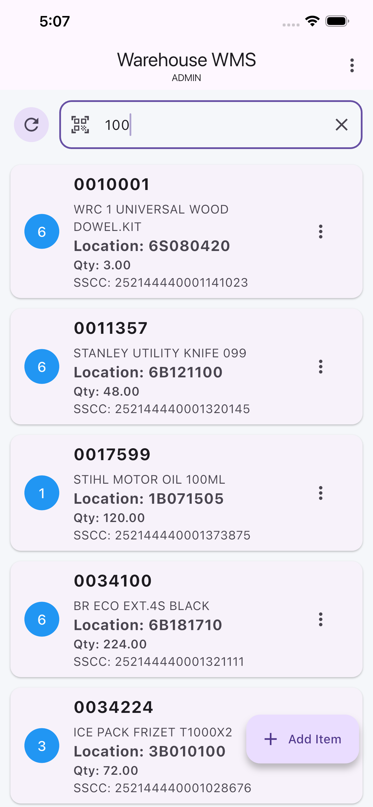
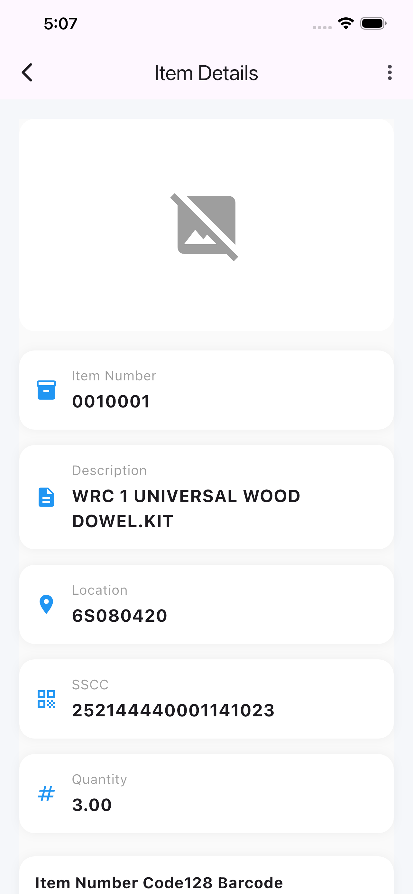
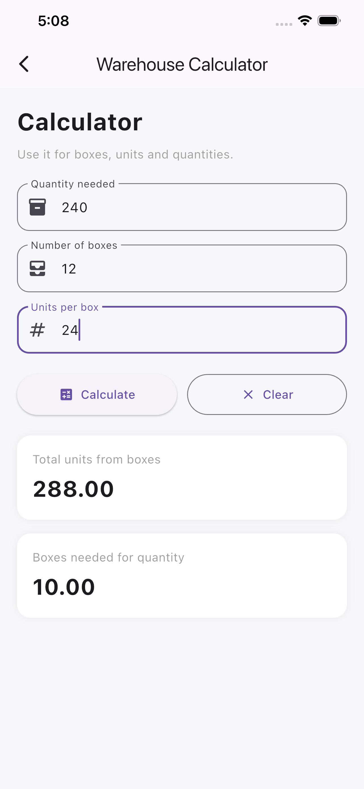

# Warehouse WMS

Warehouse WMS is a cross-platform inventory management application designed to help warehouse teams search stock, update quantities, scan barcodes, and review movement history from one clear workspace.

> The production source code and inventory data are private. This repository is the official public product, support, and release information hub.

## Features

- Search by item number, description, location, or SSCC.
- View item quantities, locations, photos, and barcode information.
- Add, edit, and organize inventory items.
- Scan barcodes with the camera or read them from saved images.
- Review inventory changes in movement history.
- Import and export inventory backups.
- Create reusable item templates.
- Calculate boxes, units, and quantities.
- Print and share item information.

## Platforms

- iPhone
- iPad
- macOS, including Apple silicon and Intel
- Android

Apple Watch is not currently supported.

## Screenshots

  
  
  

## Status

Warehouse WMS is currently being prepared for distribution through Apple's App Store. Product and release information will be updated here.

## Support

Read [SUPPORT.md](SUPPORT.md) before opening an issue. You can use the [issue tracker](https://github.com/Cybermiliko/warehouse-wms/issues) for reproducible bugs, feature requests, and general product questions.

## Donate

If you would like to support continued development, read [DONATE.md](DONATE.md). A verified payment link will be added after an official donation channel is configured.

## Privacy reminder

Never post passwords, customer information, full inventory exports, signing files, or other confidential data in public issues.

## Ownership

Copyright © 2026 Diego Alejandro Nunez. All rights reserved.
